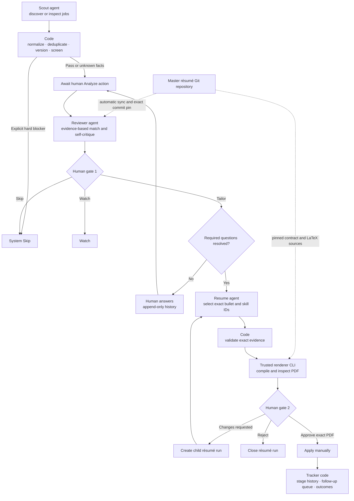

# RoleLoop

RoleLoop is a local, evidence-first job-search workflow. It discovers and evaluates roles,
creates a tailored résumé from exact claims in a trusted master-résumé repository, and tracks
manual applications without allowing an AI model to invent evidence or submit on your behalf.

RoleLoop has exactly three AI agents. Everything else—including screening, freshness checks,
evidence validation, rendering orchestration, approvals, and application tracking—is
deterministic code.



## Requirements

- Python 3.11+
- Git
- `latexmk` with a TeX distribution
- Poppler (`pdfinfo` and `pdftotext`)
- A compatible master-résumé Git repository containing
  `roleloop_contract/v1/cli.py`

Install the development environment and verify it:

```console
uv sync
uv run roleloop doctor
```

Run the Textual application:

```console
uv run roleloop
```

RoleLoop stores SQLite state and content-addressed artifacts in the platform-specific user data
directory. Set `ROLELOOP_DATA_DIR` to use another location.

## Demo quickstart

Demo mode has the same schemas and workflow as OpenAI mode, but produces deterministic offline
results. The Textual onboarding form can create this profile interactively. For a CLI-only setup:

```console
uv run roleloop profile create --name "US startup search" \
  --role "Senior AI Engineer" --provider demo \
  --location "Remote from Ecuador" --salary-floor 100000 \
  --target-hq-country "United States" --require-startup \
  --accepted-remote-arrangement "remote from Ecuador" \
  --accepted-hiring-arrangement "international contractor" \
  --query "senior AI engineer US startup remote Latin America"
uv run roleloop resume-source configure /absolute/path/to/master-resume \
  --kind local_git --ref HEAD --trust-contract
uv run roleloop doctor
uv run roleloop find --limit 20
uv run roleloop inbox
```

Use `analyze JOB_ID` explicitly for a promising job. A passing current review and qualifying
answers are required before `decide JOB_ID tailor`. Tailoring immediately starts the Resume agent,
exact-evidence validation, and native PDF rendering.

## OpenAI quickstart

Export the API key only in the process environment; RoleLoop never stores it:

```console
export OPENAI_API_KEY='...'
uv run roleloop profile create --name "OpenAI search" \
  --role "Senior AI Engineer" --provider openai \
  --location "Remote from Ecuador" \
  --query "senior AI engineer remote Latin America"
uv run roleloop resume-source configure /absolute/path/to/master-resume \
  --kind local_git --ref HEAD --trust-contract
uv run roleloop provider status
uv run roleloop doctor
```

When using the TUI, choose **OpenAI** during onboarding. Scout, Reviewer, and Resume default independently to
`gpt-5.6-terra` with medium reasoning. Scout alone receives hosted web search. RoleLoop sends
untrusted job descriptions as data and stores normalized results and audit metadata—not raw API
payloads or hidden reasoning.

## Master-résumé repository

The master-résumé repository is the source of truth for résumé facts and native LaTeX rendering.
RoleLoop is the source of truth for workflow, jobs, reviews, approvals, submissions, and tracking.
The bridge path is fixed at `roleloop_contract/v1/cli.py`; repository metadata cannot nominate an
alternate executable.

Configure either a local checkout or a remote Git URL:

```console
uv run roleloop resume-source configure /absolute/path/to/master-resume \
  --kind local_git --ref HEAD --trust-contract

uv run roleloop resume-source configure git@github.com:OWNER/master-resume.git \
  --kind remote_git --ref main --trust-contract

uv run roleloop resume-source show
uv run roleloop resume-source sync
```

Trust applies to the configured repository and ref, including its future commits, because the
versioned bridge is executed during sync/render. RoleLoop never modifies the live working tree.
It refuses dirty local repositories, fetches a managed remote cache instead of recloning for each
job, resolves the ref to one commit, archives that exact snapshot, and stores it immutably. Analyze
syncs and pins the latest commit before any paid Reviewer call. A later sync cannot change an
in-flight or submitted chain; refreshing a case creates a new review.

Environment variables are startup defaults only:

```text
ROLELOOP_AGENT_PROVIDER
ROLELOOP_SCOUT_MODEL
ROLELOOP_REVIEWER_MODEL
ROLELOOP_RESUME_MODEL
ROLELOOP_SCOUT_REASONING_EFFORT
ROLELOOP_REVIEWER_REASONING_EFFORT
ROLELOOP_RESUME_REASONING_EFFORT
ROLELOOP_RESUME_REPOSITORY
ROLELOOP_RESUME_REPOSITORY_KIND
ROLELOOP_RESUME_REF
OPENAI_API_KEY
```

Once a profile is configured, its persisted non-secret settings win over environment defaults.
This prevents a shell change from silently changing an established workflow. `OPENAI_API_KEY`
remains environment-only. Environment settings prefill onboarding and omitted per-agent CLI
options; the provider choice and repository trust acknowledgement still require explicit input.

## CLI workflow

The CLI and TUI call the same application services. The complete command families are:

```text
profile create|import|show|update|activate
provider status
doctor
resume-source configure|show|sync
find
add URL
inbox
analyze JOB [--rerun]
answer JOB QUESTION yes|no|unknown
answer-history JOB QUESTION
decide JOB tailor|watch|skip
resume show|open|export
resume retry
resume revise --feedback
resume approve|reject
application submit --follow-up YYYY-MM-DD
application stage STAGE (--follow-up DATE|--no-follow-up)
application history
followups due|resolve|reschedule
history JOB
legacy import-master-state --preview|--apply
```

The legacy command defaults to the configured local résumé repository; an explicit local path may
also be supplied after `import-master-state`. Always preview before applying:

```console
uv run roleloop legacy import-master-state --preview
uv run roleloop legacy import-master-state --apply
```

Mutating commands use idempotent command receipts, and machine-readable commands support stable
JSON envelopes. The TUI exposes the same actions with progress, source links, evidence and skeptic
findings, append-only answers, résumé lineage, exact-selection diffs, and one chronological history.

## Human gates and tracking

Gate 1 is the explicit `tailor`, `watch`, or `skip` decision. Explicit hard blockers are skipped by
code before Reviewer cost. Unknown eligibility facts become stable required questions. Watch may
retain unresolved questions; Tailor requires all required questions to have qualifying answers and
a fresh Reviewer result after those answers.

Gate 2 binds approval to the checksum of one current RoleLoop PDF. Feedback creates a child résumé
run; it never overwrites history. RoleLoop rejects submission with an external, missing, rejected,
or stale résumé. The actual application is always manual.

Supported application stages are:

```text
submitted
acknowledged
recruiter_screen
hiring_manager_screen
assessment
technical_interview
final_or_onsite
offer
rejected
withdrawn
no_response
```

Stages may skip forward and interview stages may repeat. `offer`, `rejected`, `withdrawn`, and
`no_response` are terminal. Submission requires a manually selected first follow-up date. Every
later nonterminal stage must either replace that date or explicitly select no follow-up; terminal
stages close open follow-ups. RoleLoop does not calculate dates or send notifications.

## Privacy and trust

- SQLite and managed artifacts stay local unless you deliberately place their directory elsewhere.
- API keys, Git credentials, SSH-agent variables, and unrelated secrets are removed from the
  renderer environment.
- The OpenAI provider uses `store=False`; only normalized outputs and bounded audit metadata are
  persisted.
- Source archives, selections, PDFs, extracted ATS text, review files, and render receipts are
  checksummed and immutable.
- Job descriptions and repository output are untrusted input. Strict schemas, path validation,
  size limits, timeouts, and independent PDF inspection guard each boundary.
- The two prototype databases in the master-résumé repository are read only. The optional legacy
  importer previews checksums/row counts and imports only `legacy_unpinned` history.

## Troubleshooting

Run diagnostics first:

```console
uv run roleloop provider status
uv run roleloop doctor
```

Common failures:

- **Another RoleLoop process is active:** close the other CLI or TUI using the same SQLite
  database, then retry. The process lock prevents restart recovery from interrupting live work.
- **Dirty local repository:** commit or stash changes, then retry Analyze or sync.
- **Contract incompatible:** check out a commit supporting contract major v1.
- **TeX/Poppler unavailable:** install `latexmk`, `pdflatex`, `pdfinfo`, and `pdftotext`, then
  rerun Doctor.
- **OpenAI unavailable:** confirm the profile uses OpenAI and `OPENAI_API_KEY` is present in the
  current process.
- **Stale review or résumé:** rerun Analyze; historical artifacts remain readable but cannot
  authorize a new submission.
- **Interrupted generation:** use explicit `resume retry`; feedback uses `resume revise` and creates
  a child run.

See [docs/ARCHITECTURE.md](docs/ARCHITECTURE.md) for boundaries and invariants and
[docs/TESTING.md](docs/TESTING.md) for the complete offline and opt-in live test runbook.

## Architecture

- `roleloop.domain`: immutable models and deterministic workflow rules; standard library only.
- `roleloop.application`: commands, queries, ports, freshness checks, and transaction orchestration.
- `roleloop.infrastructure`: SQLite migrations, providers, Git snapshots, trusted contract runner,
  artifact store, PDF inspection, and read-only legacy import.
- `roleloop.adapters.tui`: the Textual application.
- `roleloop.adapters.cli`: the headless command adapter and default TUI launcher.

## Development

```console
uv run pytest
uv run ruff check .
uv run ruff format --check .
uv run ty check
uv build
```

Normal tests make no live calls. The opt-in smoke makes exactly one Scout, Reviewer, and Resume
request when both variables are present:

```console
ROLELOOP_RUN_LIVE_OPENAI=1 OPENAI_API_KEY='...' uv run pytest -m live_openai
```
