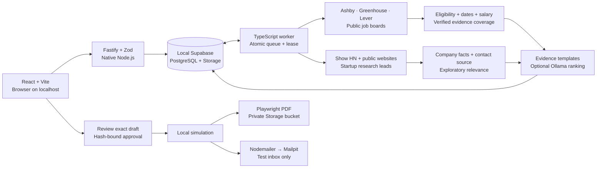

# Local architecture

The UI, API and worker are native Node.js processes. Only Supabase uses Docker. The browser talks to `/api` through Vite's development proxy; the production local server serves the compiled UI itself. Credentials are loaded only in server processes from `app/.env.local`.

The worker claims durable database rows with `FOR UPDATE SKIP LOCKED`. A renewable database lease prevents overlapping worker owners and protects recovery. Interrupted runs are marked failed, so test delivery is not automatically retried. Queue insertion deduplicates equivalent active tasks atomically. Scheduled discovery depends on the worker and the machine remaining awake.

Job coverage uses verified evidence for each requirement, with essential requirements weighted at 80% where both essential and preferred requirements exist. A matching skill does not prove years of experience, credentials or legal eligibility. Startup relevance is a separate exploration measure. Unknown facts remain review items; explicit contradictions are exclusions. Publication timestamps are distinct from discovery timestamps.

Sources and website content are untrusted data. Bounded public-website requests validate and pin DNS, reject private/reserved addresses, validate every redirect, and cap response size/time. The model endpoint is restricted to localhost and refuses redirects. Model output can only select existing evidence IDs. HTML is escaped before PDF rendering and the document browser blocks network requests.

Approval binds the profile, preferences, source opportunity, and exact draft text. Draft mutations revoke approval. Execution checks these values again before local simulation. No code path submits a real application or sends external mail. This is a testing foundation; future real delivery should use provider-specific adapters and separately defined authorization.
