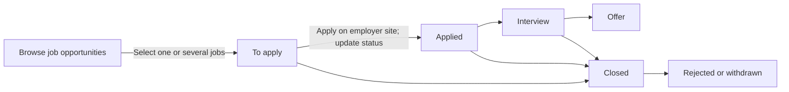
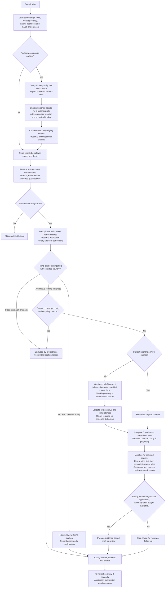

# Local architecture


The UI, API and worker are native Node.js processes. Only Supabase uses Docker. The browser talks to `/api` through Vite's development proxy; the production local server serves the compiled UI itself. Credentials are loaded only in server processes from `app/.env.local`.

The worker claims durable database rows with `FOR UPDATE SKIP LOCKED`. A renewable database lease prevents overlapping worker owners and protects recovery. Interrupted runs are marked failed, so test delivery is not automatically retried. Queue insertion deduplicates equivalent active tasks atomically. Scheduled discovery depends on the worker and the machine remaining awake.

Job coverage uses source-supported evidence for each requirement, with essential requirements weighted at 80% where both essential and preferred requirements exist. A matching skill does not prove years of experience, credentials or legal eligibility. Startup relevance is a separate exploration measure. Unknown facts remain review items; explicit contradictions are exclusions. Publication timestamps are distinct from discovery timestamps.

Sources and website content are untrusted data. Bounded public-website requests validate and pin DNS, reject private/reserved addresses, validate every redirect, and cap response size/time. AI requests use the fixed OpenAI Responses endpoint and refuse redirects. Assessment and drafting outputs can only select existing evidence IDs. HTML is escaped before PDF rendering and the document browser blocks network requests.

Approval binds the profile, preferences, source opportunity, and exact draft text. Draft mutations revoke approval. Execution checks these values again before local simulation. No code path submits a real application or sends external mail. This is a testing foundation; future real delivery should use provider-specific adapters and separately defined authorization.

## Resume facts

The resume flow separates three responsibilities:

```text
Private original PDF/DOCX
  → versioned career records and source statements
  → opportunity-specific assessment and application drafts
```

The original is the source of truth. Derived facts describe the career independently of any target role. Assessments and drafts select from those facts; they do not rewrite the underlying record or trigger extraction for each opportunity. Search preferences remain separate from resume claims.

### Extraction contract

`app/src/shared/types.ts` defines the versioned contract. `CareerFactsSchema.sections` groups experience, projects, education, certifications, listed skills, languages and other career details. A section holds its title, organization, period, original source passage and evidence IDs. `facts.evidence` stores atomic quotations and supported skill tags, preserving the existing matching and drafting interface. This lets the presentation evolve without making each statement an independent career entry.

`resume-import.ts` indexes the original text into numbered, bounded source units and requests compact ranges in structured output. Embedded PDF/Word HTTP(S) links are deduplicated and appended as bounded source context; linked pages are never fetched and the visible text retains its existing offsets. The model classifies records and selects ranges; the server reconstructs statements directly from the source. Range bounds and containment are checked before validation, so the model cannot supply rewritten quotations. This avoids generating both a full source passage and duplicate bullet text, and disambiguates identical text at different positions. Metadata must also occur within that passage, and tags must be literal skill names in the statement. `source-quotations.ts` tolerates whitespace and Unicode presentation differences while retaining original spelling and UTF-16 offsets into extracted document text. Duplicate statements are removed and source order is retained. Matching titles and employers are merged only when their source passages overlap, keeping separate engagements distinct when dates are missing. Missing fields remain empty; extraction does not infer tenure, proficiency or job-search preferences. Instructions inside documents are untrusted content, never extraction instructions.

A traceable quotation proves presence in the source, not independent truth or correct semantic interpretation. The stored `verified` flag means source-supported, not employer-verified or human-approved. Users review the source passages and extraction notes; corrections currently happen by updating and replacing the resume. There is no competing editable copy of career facts.

### Matching and presentation

Listed skills and language claims retain their categories through matching and drafting. They can indicate relevance but cannot alone produce a full requirement match or satisfy a mandatory condition. Contextual evidence and transferable experience remain distinguishable from a bare keyword list. Role-specific assessments cite evidence IDs, and drafts keep listed claims separate from career highlights.

The **Resume** workspace separates document actions from the career review. `ResumeFacts.tsx` has one category registry for section order and labels, shared by navigation and grouped records. Search, expandable evidence and source passages operate on the same contract. New categories or metadata should extend the shared schema, extractor validation and matching semantics together; display changes belong in the review component and its scoped stylesheet.

### Cache lifecycle and persistence

`CV_EXTRACTOR_VERSION` is currently 2. `careerFacts()` is the common access gate: only a ready cache for the active source and current extractor version can supply facts. Upload activates a new source and removes the old cache before processing. Retry reuses the private original. Clearing extracted details removes only the cache, leaving originals, drafts and history intact. Processing, upload and reset use compare-and-swap writes; late responses and stale clear requests cannot overwrite a newer state. `update_workspace_profile_if_current` compares profiles atomically inside PostgreSQL with JSON parameters in the request body, avoiding URL-size limits for large resumes. It merges only validated supplied workspace fields, preserves independently changed settings, and uses the caller's existing row-level permissions.

The v2 migration updates the database profile cleaner and invalidates v1 caches while preserving source references and stored files. Future contract changes must update both the runtime version gate and database cleaner/migration. Avoid adding parsed defaults to persisted profiles without normalizing existing rows: compare-and-swap compares stored JSON. The extraction request has a five-minute deadline configured in `shared/resume-processing.ts`; other AI calls retain their existing default. The stream reader collects `response.output_item.done` items by output index, then accepts them only after `response.completed`; some subscription responses leave the terminal event's output array empty. A populated terminal output takes precedence so text is never concatenated twice. The reader does not wait for socket EOF; incomplete, failed and interrupted streams remain failures even if text was already received. Cache `startedAt`/`expiresAt` metadata prevents duplicate active retries and exposes recovery after interruption or expiration. Optional `errorCode` distinguishes service timeouts from source errors without changing the v2 facts contract or adding defaults to old stored JSON. Inference is never automatically retried or switched to API billing. Re-extraction is explicit. Existing documents remain downloadable, while profile fingerprints require fresh generation before approval after source or fact changes.

## Accounts and isolation

Supabase Auth owns account credentials. The API verifies the bearer token through Auth and constructs a new Supabase client with that user's token for each ordinary request. It verifies ownership of the selected workspace, then passes an explicit scoped store into services. Row-level policies enforce the same boundary when a user calls Supabase directly. The browser never receives a service key.

`workspace.owner_user_id` is the source of access: only the owner can use a workspace. Historical `workspace_members` rows remain for provisioning compatibility but grant no access; membership endpoints and the sharing RPC are removed. `app_admins` permits account administration, without implicitly granting access to any workspace. Each new account receives a blank personal workspace. Existing `default` data stays unclaimed until an authenticated user presents a one-time local setup key. Only its digest and expiry are stored in global runtime state; claiming consumes it atomically.

Every opportunity, draft, run, event, and user runtime entry has a workspace ID. Source uniqueness and queued-task deduplication include this ID. Draft references use a composite workspace/opportunity foreign key. Workers use privileged access only with the workspace from the claimed SQL row; global worker leases and heartbeat remain separate. Scheduling and daily draft limits are per workspace. Stored SQL IDs and relationships override JSON copies, and safe-ID constraints prevent object-path traversal.

Documents use workspace-prefixed private object paths. Browser downloads go through a scoped authenticated API; direct Storage reads require ownership. Existing legacy objects remain private and authorized downloads re-render their saved drafts. The UI captures account/workspace context for each request, rejects responses from stale contexts, and remounts workspace state after switching. Historical manager memberships cannot authorize API or database access, including with an existing JWT.

Tests cover API and direct RLS isolation, denial of historical manager access, administrator boundaries, queue/source deduplication, private Storage, payload tampering, and initial-owner setup. Integration fixtures are isolated and removed; SQL setup checks use rollback. Studio/Mailpit/Docker remain trusted host-level developer surfaces outside RoleLoop account isolation.


## Local ChatGPT plan connections

Each RoleLoop user has a separate protected connection file under `.local/chatgpt/`, with independent issued-client registrations, selected account/model, OAuth credentials and billing choice. Loopback callbacks validate one-time state, PKCE, signed ID-token audience/issuer/nonce and returning subject before activating an account. The frontend receives display metadata only. Subscription inference requires plan-usage consent, uses the account model catalog and streamed Responses with `store: false`, and never falls back to API billing. File locks serialize refreshes across API and worker processes; token replacements are atomic.

The database stamps each run's immutable `requested_by` from the authenticated identity. Workers disregard requester IDs in JSON payloads, recheck workspace ownership, and load only that requester's connection. Scheduled tasks have no subscription requester and use API configuration. Tests use signed fixture tokens and mocked OpenAI responses; live connection requires the user to complete sign-in and consent.

## Practical job search workflow

Company sources carry optional country and official evidence URL; imported listings inherit both. This is independent of remote hiring eligibility. The researched library contains nine US employer boards across Greenhouse, Ashby and Lever, plus Jobicy (broad remote discovery, employer country unverified). Each employer includes official country evidence and a dated board-check snapshot. Internal source connections use case-insensitive provider/board identity and preserve workspace custom labels and paused states. New workspaces receive the library by default. Provider docs: https://jobicy.com/jobs-rss-feed and https://github.com/lever/postings-api. Jobicy feed requests share a persisted hourly installation cache, with bounded cursor traversal; local keywords do not change stable provider IDs. Full-board ATS results and bounded Lever pagination replace the prior first-100 truncation. Missing feed entries never imply closure.

Application progress is separate from matching stage inside each opportunity payload. Submission/interview/offer timestamps, next action, follow-up date and notes survive source refreshes. Progress-only API edits avoid re-evaluation and draft invalidation. Source outcome counts retain interview/offer milestones after rejection. Bootstrap unions the latest 300 discoveries with a paginated workspace-scoped query of all tracked jobs, deduplicated by ID; older untracked discovery history is not loaded. Application submission remains manual through the listing URL.


The board uses `application-board.ts`: an existing `Opportunity.application` object is explicit membership, and its legacy `saved` status renders as To apply. Imported jobs without progress are not automatically tracked. Board columns are To apply, Applied, Interview, Offer, and Closed; Closed retains rejected/withdrawn outcomes. `ApplicationsBoard.tsx` supports drag-and-drop plus keyboard-accessible status selects. Closing a card by drag requires choosing the outcome before persistence. All moves preserve application notes and dates and use progress-only PATCH operations. Archived jobs retain history but leave the active board. Job details and board cards share the same evaluation/draft tools in a native modal.



Requirements retain source statements beyond the recognized software tags. Missing structured requirements render as unevaluated in the list. Tenure/credential conditions cannot be proven by skill mentions: capability support can be partial while the condition remains a review item. Company headquarters is checked when a country preference is set; ambiguous location text stays unknown. Successful semantic assessments are reused for up to one day with opportunity, profile, preference and requester fingerprints. Hard exclusions and unrelated roles use deterministic assessment; globally ordered ready candidates receive the daily draft budget. Public job-page capture uses the existing DNS-pinned, size/time-bounded research transport and never executes page scripts.

Source health is written independently to the workspace-scoped `source-health` runtime record after each source completes or fails. Bootstrap returns the latest per-source check, while Activity shows search history and failures. These checks may come from different runs and do not assert that a job remains open. Manual board links are explicitly separate from automated connectors. Oversized connector descriptions and captured pages carry `descriptionTruncated`; matching treats this as uncertainty and fingerprints it only when true, preserving existing hashes for complete descriptions.

Activity separates live tasks from a dated history of the latest 100 runs and 60 events. New events carry optional category and run references, allowing updates from one task to be grouped without inferring relationships from timestamps. Search runs persist distinct newly saved and previously saved nonarchived opportunity counts, successful evaluations, prepared drafts, source attempts/failures, connected companies and draft failures. Saved counts can exceed evaluations when a later step fails. Partial source, drafting or employer-discovery outcomes are marked explicitly. Application status transitions, manual additions, archive/restore actions, preferences and CV processing are recorded; ordinary text edits and downloads are not.

The Activity presentation model translates both legacy and current errors into an explanation and next step, retaining diagnostics under a collapsed disclosure. Historical failures are not presented as current blockers. Filters and search include nested task updates; page links can select the related opportunity or draft through the hash route. Older records remain unchanged and do not acquire invented result counts. The design follows [NN/g error-message guidance](https://www.nngroup.com/articles/error-message-guidelines/), [GOV.UK progressive disclosure](https://design-system.service.gov.uk/components/details/) and [WCAG status-message guidance](https://www.w3.org/WAI/WCAG22/Understanding/status-messages.html): visible recovery guidance, optional diagnostics, redundant status labels and concise live announcements.

## Discovery entities and purpose

Migration 20261106000400 separates `companies` (identity and country evidence), `discovery_sources` (company_board, job_feed, startup_feed connections), and `opportunities` (individual jobs or prospects). Foreign keys include workspace ID. Companies and connections are read through RLS; connection writes are an authorized workspace patch normalized by a non-callable trigger, with rollback on invalid or duplicate identities. Source JSON is removed from the stored workspace. The existing API returns a joined compatibility shape, plus company records. This avoids two writable copies of company data in persistence.

Opportunity insertion links the source’s company or an explicitly selected known company. Unresolved employers receive a provider-scoped company identity; names alone never merge different providers. Manual entry offers existing companies by name. Unfollowing deletes the connection, nulls the nullable relational source reference, and preserves company records, source snapshots and applications. Country evidence edits apply to the company entity; duplicate connections with unchanged data cannot overwrite edits from another connection in the same request.

Discovery runs carry optional `discoveryScope` (jobs/startups). Unscoped batch runs and schedules default to jobs; a legacy run targeting a specific source still works. The worker filters before fetching, and queue deduplication includes scope. The UI starts job searches from Job opportunities and startup research from Startup prospects. Source configuration stays internal. Manual browsing links live in Add role and never become automated connections. Unconfigured startup research uses the built-in Show HN feed without creating a workspace subscription; configured feed keywords and paused states take precedence.

Shared feed caches store public snapshots, not workspace identity. Each use receives a new internal record ID and the current source reference before workspace-scoped source-key deduplication. This prevents a cached UUID from conflicting with another workspace’s primary key. The regression test imports the same snapshot into two workspaces and verifies stable refresh within each one.

Migration 20261106000500 adds `workspace.sources_revision`, source provenance and workspace-scoped `discovery_source_suppressions`. `replace_discovery_sources` checks the revision while holding the workspace row lock; `connect_discovered_source` is service-role-only and appends under the same lock, preserving existing and disabled identities, company evidence, removal suppression and the 50-source cap. `PUT /sources` requires `expectedRevision` and returns the authoritative sources and revision. The resume action reads the current revision before re-enabling a paused search; stale edits fail without queuing a search.

Full job searches may expand employers before importing followed boards. `domain/employer-discovery.ts` queries Himalayas by role/country, keeps employer metadata only, obtains an observed company website from the official company-details tool, and follows bounded public careers links through DNS-pinned `safeFetchText`. Supported ATS boards must contain a matching opening without known eligibility/pay/date blockers. Unknown headquarters is never inferred from job location or a directory's general location. No directory job is republished; stable ATS source keys retain one opportunity and application history across discovery and refresh. Newly fetched ATS jobs are reused only while their connection identity still matches, with current company facts overlaid.

Search metadata uses a daily global cache, careers metadata a seven-day cache, and failures a one-hour backoff; none contains CV/contact data or workspace IDs. Expansion is bounded to three roles, two pages per role, twelve employer checks and five connected boards. Its latest report is stored in workspace runtime and returned by bootstrap. Failures leave normal followed-source searches usable. Missing preferences skip expansion; changed preferences or a paused setting stop appends. Matching uses full role terms with limited developer/engineer and software-specialty aliases. The discovery toggle is excluded from preference fingerprints and does not invalidate drafts. Assessments recheck both CV and matching-preference fingerprints before saving.

Directory queries prioritize advertised salary when the candidate has a floor and cache that ordering separately. Role checks ignore an appended employer name and require an explicitly requested management role for management titles. The default job view shows potential matches, with all saved roles accessible through other browsing views and application history on the separate Applications board. ATS text cleanup handles one escaped HTML layer. A conservative fallback reads explicit salary currencies/ranges/periods from titles and labelled compensation sections only when structured amounts are absent; ambiguous currencies, OTE and unrelated financial amounts are not treated as base salary. Unknown periods remain unknown, regardless of the apparent magnitude of the amount.

## Country-aware job evaluation

The selected working country controls eligibility. `assessGeography` returns `eligible`, `review`, or `excluded`, separately from career fit. Explicit residence restrictions override broad remote labels; a finite city dictionary resolves Bangalore/Bengaluru and other known locations, while unfamiliar places stay unresolved. The algorithm requires affirmative compatible remote hiring evidence rather than interpreting the absence of a restriction as permission. Headquarters, offices, customers and time-zone overlap do not establish candidate residence. Conflicting evidence remains reviewable.



Job and startup prompts are separate named constants in `server/fit.ts`. Job instructions ask for demonstrated outcomes, truthful transferable evidence, concrete gaps and a useful next action, without inventing tenure, credentials, residence or success probabilities. The structured response must cover each extracted requirement exactly once and cite existing career-fact IDs. Preferred qualifications cannot become mandatory through parsing or prompting. An unavailable or invalid AI response falls back to deterministic review.

`Assessment.geography` persists the eligibility status, working country and unresolved/blocking reasons. The default job view requires a current-country eligible status and the existing role/preference checks. The browsing views are matches, review, all saved and archived. Applications is a separate board. `opportunity-views.ts` intersects optional detail filters with the selected view; `OpportunityFilters.tsx` reveals only relevant refinements under More filters. Changing views or opening a job deep link clears the detail filter; changing browsing filters clears checkbox selections. Location-review and excluded refinements preserve access to saved records without crowding the main view selector. These categories describe advertised scope, not independent verification that an employer can legally employ a particular candidate. Remote mode and restrictions come from the posting; a strong skills score cannot override them.

Employer expansion requires at least one location-compatible opening. Both search and manual evaluation avoid AI calls for definite policy blockers or unresolved job locations; automatic drafting additionally requires geographic eligibility and overall readiness. `ASSESSMENT_RULES_VERSION` triggers local reassessment of saved records without paid AI calls, preserving previous semantic matches and application history. `FIT_PROMPT_VERSION` participates in the AI cache fingerprint, so a later eligible search cannot reuse the previous prompt's cached result.

Incomplete stored geography is treated as missing derived data and rechecked even when the assessment already has the current rules version. Bootstrap limits reassessment to four concurrent jobs while retaining per-job preference freshness checks. Opportunity and draft writes are validated before mutation, with strict validation for supplied geography, so an incomplete runtime snapshot cannot corrupt a previously valid record.

## Shared source catalog

Migration `20261107000100` changes source ownership into a many-to-many relationship. Global `discovery_sources` contains connector identity (`id`, `kind`, `provider`, canonical `board`); `workspace_sources` contains each workspace’s connection (`workspace_id`, legacy `id`, `source_id`, `label`, `enabled`, `keyword`, `company_id`, ordering and discovery provenance). Company board identity is provider plus lowercase board. Feed identity is provider plus empty board, so workspace keywords never create global catalog variants. Multiple keyword subscriptions remain distinct per workspace.

The migration preserves connection IDs, source revisions, suppression records and opportunity foreign keys. `opportunities.discovery_source_id` continues to reference the workspace connection, not the shared catalog. Removing a connection keeps other workspaces and application history intact; a catalog source is retained even when it has no current subscriptions. Private company evidence stays in workspace-scoped `companies` rather than being copied from the first subscriber into shared data.

The store joins connections to catalog rows and returns the existing API shape, adding optional `catalogId`; `Source.id` remains the connection ID. Validated writes resolve catalog identity from provider and board, never trust a caller-supplied catalog ID, and retain the existing per-workspace revision lock and worker append behavior. Catalog writes are not granted to app accounts. Catalog reads require a connection in an accessible workspace, and subscription reads remain workspace-scoped. Local Studio’s privileged database role can inspect the complete catalog and subscription graph.
