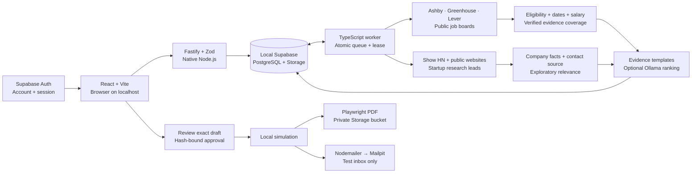

# Local architecture

The UI, API and worker are native Node.js processes. Only Supabase uses Docker. The browser talks to `/api` through Vite's development proxy; the production local server serves the compiled UI itself. Credentials are loaded only in server processes from `app/.env.local`.

The worker claims durable database rows with `FOR UPDATE SKIP LOCKED`. A renewable database lease prevents overlapping worker owners and protects recovery. Interrupted runs are marked failed, so test delivery is not automatically retried. Queue insertion deduplicates equivalent active tasks atomically. Scheduled discovery depends on the worker and the machine remaining awake.

Job coverage uses verified evidence for each requirement, with essential requirements weighted at 80% where both essential and preferred requirements exist. A matching skill does not prove years of experience, credentials or legal eligibility. Startup relevance is a separate exploration measure. Unknown facts remain review items; explicit contradictions are exclusions. Publication timestamps are distinct from discovery timestamps.

Sources and website content are untrusted data. Bounded public-website requests validate and pin DNS, reject private/reserved addresses, validate every redirect, and cap response size/time. The model endpoint is restricted to localhost and refuses redirects. Model output can only select existing evidence IDs. HTML is escaped before PDF rendering and the document browser blocks network requests.

Approval binds the profile, preferences, source opportunity, and exact draft text. Draft mutations revoke approval. Execution checks these values again before local simulation. No code path submits a real application or sends external mail. This is a testing foundation; future real delivery should use provider-specific adapters and separately defined authorization.

## Accounts and isolation

Supabase Auth owns account credentials. The API verifies the bearer token through Auth and constructs a new Supabase client with that user's token for each ordinary request. It verifies the selected workspace membership, then passes an explicit scoped store into services. Row-level policies enforce the same boundary when a user calls Supabase directly. The browser never receives a service key.

`workspace.owner_user_id` identifies ownership; `workspace_members` records owner/manager access. Owners alone grant/revoke managers through an authenticated database function. `app_admins` permits account administration, without implicitly granting access to any workspace. Each new account receives a blank personal workspace. Existing `default` data stays unclaimed until an authenticated user presents a one-time local setup key. Only its digest and expiry are stored in global runtime state; claiming consumes it atomically.

Every opportunity, draft, run, event, and user runtime entry has a workspace ID. Source uniqueness and queued-task deduplication include this ID. Draft references use a composite workspace/opportunity foreign key. Workers use privileged access only with the workspace from the claimed SQL row; global worker leases and heartbeat remain separate. Scheduling and daily draft limits are per workspace. Stored SQL IDs and relationships override JSON copies, and safe-ID constraints prevent object-path traversal.

Documents use workspace-prefixed private object paths. Browser downloads go through a scoped authenticated API; direct Storage reads require membership. Existing legacy objects remain private and authorized downloads re-render their saved drafts. The UI captures account/workspace context for each request, rejects responses from stale contexts, and remounts workspace state after switching. Revocation blocks subsequent API and database access even with an existing JWT.

Tests cover API and direct RLS isolation, manager revocation/escalation, administrator boundaries, queue/source deduplication, private Storage, payload tampering, and initial-owner setup. Integration fixtures are isolated and removed; SQL setup checks use rollback. Studio/Mailpit/Docker remain trusted host-level developer surfaces outside RoleLoop account isolation.
