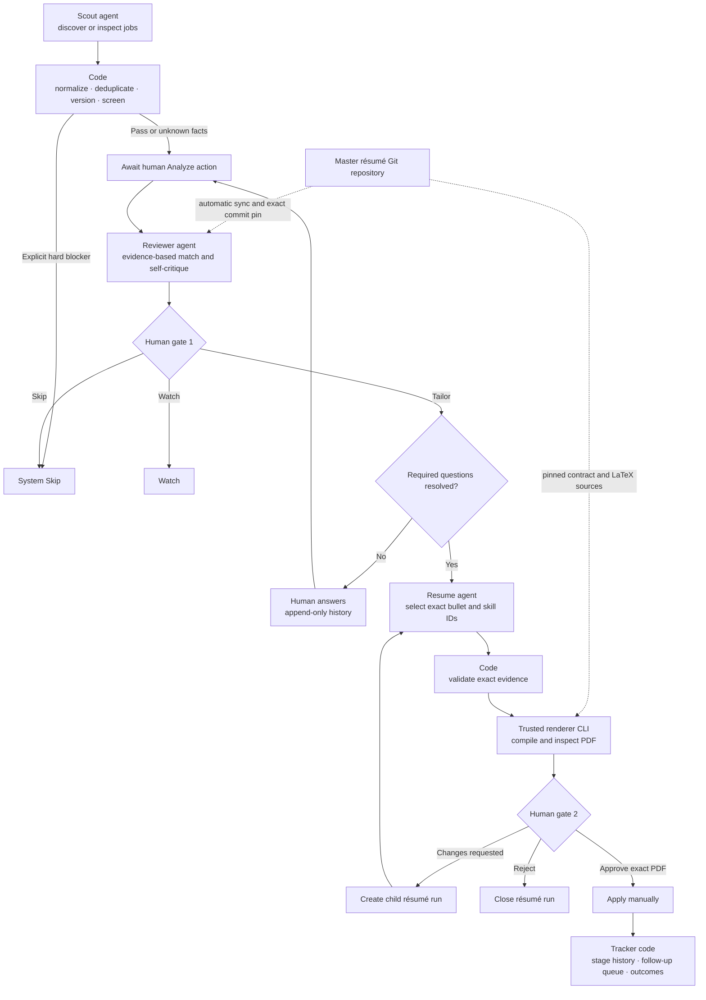

# RoleLoop architecture

RoleLoop has exactly three nondeterministic agents: Scout, Reviewer, and
Resume. Every other node is ordinary code or an explicit human boundary.

## Ownership

RoleLoop owns search profiles, job and source observations, agent runs, human
decisions, immutable artifacts, application history, and the SQLite database.
The master-resume repository owns canonical résumé evidence, exact-selection
validation, LaTeX templates, and native rendering through contract v1.

The master repository is not cloned for every job. Remote sources use a managed
cache; local sources are read-only. Analyze resolves a clean exact Git commit,
stores an immutable source bundle, and pins the resulting evidence version to
the review. Tailoring, feedback children, approval, and submission continue to
use that bundle even if the repository later advances.

## Authoritative invariants

- A deterministic hard blocker can Skip a job without spending a Reviewer call.
- Reviewer runs only after the operator selects Analyze.
- Watch needs a current review. Tailor additionally needs every required answer
  to qualify and a fresh review incorporating those answers.
- Resume emits a headline plus ordered IDs. It cannot author résumé facts.
- Every selected bullet and skill must exist and be active in the pinned
  evidence catalog. The master summary remains exact.
- Generated means machine-complete, not human-approved.
- Approval binds one generated PDF artifact and checksum.
- Submission requires that current approval and a manually chosen follow-up
  date. RoleLoop never submits a third-party form.
- Answers, decisions, reviews, résumé reviews, application stages, and follow-up
  resolutions are append-only.
- Provider, prompt, schema, source, contract, and renderer changes participate
  in freshness fingerprints.

## Trust boundary

The configured master repository is executable trusted content. RoleLoop only
invokes the fixed `roleloop_contract/v1/cli.py` path from an exact archived
commit; repository metadata cannot select another command. It uses argv without
a shell, closes stdin, strips credentials and API keys, applies time and size
bounds, rejects unsafe archives and output paths, and imports only validated
content-addressed artifacts.

Trust applies to the configured repository/ref and future commits. A dirty
local working tree fails before any paid provider call. The renderer never
receives `OPENAI_API_KEY` or Git authentication state.

## Provider boundary

Demo and OpenAI implement the same typed outputs. OpenAI uses the Responses API,
strict structured output, `store=False`, and medium reasoning. Scout alone can
use hosted web search. Reviewer and Resume see only normalized job facts and
the minimum canonical evidence required for their operation.

RoleLoop persists normalized outputs, source URLs, provider response IDs, model
and token usage, and prompt/schema hashes. It does not persist raw transport
payloads or hidden reasoning.

## Application stages

The fixed stages are `submitted`, `acknowledged`, `recruiter_screen`,
`hiring_manager_screen`, `assessment`, `technical_interview`,
`final_or_onsite`, `offer`, `rejected`, `withdrawn`, and `no_response`.
Interview stages may repeat and stages may be skipped forward. Offer, rejection,
withdrawal, and no response are terminal and close outstanding follow-ups.
